# gtr-mfd

An R35-style multifunction display for your GitHub profile. Every night a GitHub Action reads your public activity and redraws the screen. It cycles through four pages, and each gauge's needle sweeps up from zero when its page comes on.



| Page | Gauge | What it reads |
|---|---|---|
| **BOOST** | Needle | Current contribution streak (an empty today doesn't break it) |
| | Bars | Contributions for each of the last 7 days, peak day in red |
| **TEMP / FUEL** | Oil temp | Open issues across your non-archived repos. Redlines at 30 |
| | Trans temp | Your open pull requests |
| | Fuel | Last 30 days of contributions vs. your own 1-year pace. 100% = on pace |
| **G-METER** | Dot | Your top four languages pull in four directions; the dot sits where the mix balances |
| **LAP TIMER** | Current lap | Time since your last merged PR |
| | Laps | Time between consecutive merged PRs, delta vs. your best |

No dependencies. Node 18+.

## Put it on your profile

1. In your profile repo (the one named exactly after your username), copy `examples/profile-workflow.yml` to `.github/workflows/mfd.yml`.
2. Go to that repo's **Actions** tab, open **GT-R MFD**, and click **Run workflow**. It creates an `output` branch with the SVGs.
3. Add this to your profile `README.md`:

   ```md
   
   ```

It redraws every night just after midnight Pacific and on every push to main.

## Run it locally

```bash
node index.js --demo                         # fake data, no token
GITHUB_TOKEN=ghp_... node index.js --user <login>
```

Output goes to `dist/`: `gtr-mfd.svg` (animated) and `gtr-mfd-0.svg` … `-3.svg` (one static page each, useful if you only want one page on your profile).

## Notes

- GitHub strips JavaScript from README images, so the page cycling is pure CSS animation inside the SVG.
- The default Actions token only sees public activity. Private contributions don't count unless you pass a personal access token as `github_token`.
- The display is an original drawing inspired by the R35's center screen. No manufacturer logos or badges.
